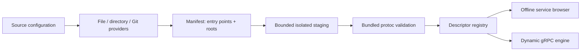

# Protobuf source management

A server profile may combine individual local `.proto` files, recursive local directories, and public or credential-backed private GitHub repositories. In **Servers → New server / Edit server**, use **Add files**, **Add folder**, or **Add Git repository** in Proto sources. Files append without replacing earlier selections. Each source has a remove control; directory selection can be changed using its folder control. Git configuration fields are editable inline, without another modal.

**Discover files** lists available files. Expand a directory/repository result and choose compilation entry points using its checkboxes, Select all or Select none. Clearing all entries intentionally selects nothing; it does not mean “all”. Discovery alone does not replace a successful revision. Click **Validate** to compile the selection. Save the server to persist it. Local files display their full paths; discovered directory/repository entries retain relative paths.

## Entry points versus import roots

Entry points determine which definitions/services are compiled. Import roots determine the meaning of an import path and are independent of entry points. Adding a root does not compile every file in it. Dependencies of selected entries are included transitively by the official compiler.

For example:

```text
project/proto/services/user.proto
project/proto/common/types.proto
```

If user.proto imports `common/types.proto`, select user.proto as an entry point and add `project/proto` as an import root. Selecting `project/proto/services` as a root cannot resolve that import. File parents and discovery directories provide automatic fallback roots. Explicit roots take precedence. On missing imports, accessible matching ancestors are suggested; select the suggested folder using the native picker to grant sandbox access. Multiple roots defining the same import name from different files, including names that collide on case-insensitive platforms, cause a deterministic conflict; reorder cannot silently select one definition.

Import roots for local sources are full local directory paths. Git import roots and Proto directory are **repository-relative**, not local paths. A blank Git root means the repository root; list multiple roots on separate lines. To compile `services/user.proto` from repository directory `proto`, set Proto directory to `proto` and Git import roots to `proto`. Roots may also point to a different dependency directory in the same repository.

Validation uses the bundled official protoc, supports proto2/proto3 and valid single/double-quoted, public and weak imports, and includes Google well-known types. Explicitly vendored standard definitions resolve from configured roots; bundled definitions remain the fallback. Editions are explicitly unsupported by the dynamic codec. Error output includes compiler filenames/line numbers and configured roots. Successful results show actual file/dependency/service/method/warning counts, discovered RPC paths and import-to-root resolution. No custom Protobuf grammar parser remains.

## Git acquisition and cache

Only public `https://github.com/owner/repository` URLs are supported initially. Supply a branch, tag or full 40-character commit SHA. GitHub REST resolves the reference to the actual commit. The corresponding codeload ZIP is fetched over verified HTTPS and only `.proto` files are extracted. No installed Git, shell clone, repository hook, build script or external protoc is needed. Nothing is uploaded. Private repository authentication and other hosts are deferred; RepositoryProvider separates hosting/acquisition from compilation and can later use an OS credential store.

Revisions live in `schema-cache/owner--repository/commit/` beside the SQLite database, outside the bundle. Downloads use a temporary sibling directory; SHA-256 file manifests, a completion marker and atomic rename publish a completely acquired immutable revision. Reuse verifies hashes and rejects modified or corrupted cache contents. Managed cache roots and revision directories cannot be symlinks. Validation must succeed before the configuration adopts its commit. **Refresh** explicitly resolves and validates a newer revision. Failure retains the saved revision and last validation metadata. Cached revisions can be reused without network access, including offline schema validation after restart. An imported workspace can use an existing matching cache; on another machine, first acquisition requires network access. Cache contents are never included in workspace exports.

No periodic background refresh runs. Fetching happens only during explicit discovery/validation/browsing or schema fallback during an explicitly requested connection. GitHub's unauthenticated REST rate limit applies to reference resolution; HTTP failures explain checking the reference/repository/rate limits. Repository renames that redirect must be corrected to their current URL. LFS pointer files are not expanded and will fail schema validation.

## Security and limits

- Fixed HTTPS API/archive hosts only; no embedded credentials, URL queries, untrusted redirects, proxy routing or local/private IP targets. DNS-resolved public IPv4 addresses are pinned for each verified TLS connection. Credentials and source contents are not logged.
- At most 64 MiB downloaded archive, 256 MiB declared repository tree, fewer than 60,000 ZIP entries (ZIP64 is unsupported), 2,048 proto files, 4 MiB per proto and 32 MiB aggregate proto content. Source discovery scans at most 100,000 entries. Cache capacity is 256 MiB; remove unused revisions when the explicit capacity error occurs. Active revisions are never automatically evicted.
- No symlinks, special archive file types, absolute/traversal paths, case-colliding archive paths, encrypted archives or unsafe extraction. ZIP CRCs and sizes are verified. Only proto files reach disk; unrelated scripts are never extracted or executed.
- Local roots are bounded and staged into a fresh isolated temporary tree. Symlinks inside source trees and selected symlinks are rejected. The compiler sees only copied files. Roots outside a user's sandbox grant produce recoverable permission/path errors; select folders with the native picker. macOS security-scoped bookmarks retain access across launches.
- Acquisition/discovery deadline: 90 seconds; individual network waits: 15 seconds; compiler: 10 seconds; archive worker: 15 seconds. Cancel operation stops work and prevents configuration adoption. Archive extraction and descriptor decoding run off the Flutter UI isolate; protoc is an asynchronous bundled subprocess.

## Connectivity

Use **Validate** in Servers → Create/Edit server → Proto sources to compile schemas and inspect discovered services/methods without contacting the endpoint. Save the configuration, then use **Connect** to load services into the workspace. Connection discovery prefers reflection; if reflection fails, configured sources supply the schema. If transport fails, valid configured definitions remain available for browsing and request editing, while RPC execution stays disabled. Reflection, compiler and transport failures retain distinct labels. Cancel in the connection toolbar cancels discovery.

## Persistence and recovery

The SQLite servers table gains `proto_sources_json`, a version-1 source-configuration envelope containing sources, import roots, selections, references, resolved commits and last successful validation metadata. Existing `proto_files_json` and `proto_folders_json` remain; valid old lists migrate to equivalent file/directory sources. Existing IDs, timestamps, collections, saved requests and history are unchanged. A consistent SQLite backup is made before migration using the existing backup mechanism. No automatic database reset runs.

Malformed legacy JSON or unsupported source/configuration versions remain stored intact. Startup continues and editing the affected server shows a recoverable error. **Replace invalid sources** is explicit; cancellation leaves the original record untouched, and only Save persists a repaired configuration. Source configuration extension fields are retained through save/export/import. Unsupported workspace record fields cause a transactional import error rather than silent data loss. New exports use workspace version 2, and existing version-1 files remain accepted. Export includes configuration/metadata, never source/cache bytes; existing credential metadata must still be handled privately.

## Manual verification on macOS

```sh
cd /Users/hops/Projects/protodesk
export PATH="/Users/hops/Development/flutter/bin:$PATH"
flutter pub get
flutter run -d macos
```

Use your existing database or an isolated absolute directory under `~/Library/Application Support/ProtoDesk/` via PROTODESK_DATA_DIR. Neither option clears existing data.

1. Create a server with an offline endpoint such as `127.0.0.1:1`. Add several local files in two picker operations; verify they append and can be removed individually.
2. Add a directory with nested service/common files. Discover, expand results, select only service entries, add the project proto root using Add import root, and Validate. Check methods, counts and root resolution. Add a missing import and verify its compiler location/root suggestion; correct it and revalidate.
3. Add `https://github.com/grpc/grpc-proto`, reference `master`, Proto directory `grpc/reflection/v1`, leave Git roots blank (repository root). Discover and select `reflection.proto`; Validate and Save. This public fixture was verified by the opt-in acquisition smoke check; repository size/resource bounds apply. Alternatively use a smaller public company schema repository.
4. Close/reopen the app. Verify local bookmarks, selections and commit persisted. Disconnect the network and Validate in the server editor to inspect the cached schema offline. Save, then Connect to the offline server. Confirm the workspace retains the cached services after the transport error and Invoke is disabled.
5. Reconnect networking, Refresh a branch-based source, then retry with an invalid reference. Confirm the previous successful source remains available when you cancel edits. Cancel discovery while it is running, and close dialogs during pending file selection/validation; no framework assertion should occur.
6. Export/import a workspace and confirm every source, root and selection survives. Confirm version-1 workspace import still works. Inspect narrower windows and long paths; the server editor scrolls without stacking additional source dialogs.

Automated tests use isolated files, SQLite stores and mocked repositories/archives; CI requires no live GitHub access. Build/package checks use the existing development (ad-hoc) path. No production release or Developer ID/notarization is performed for this feature.

## Architecture and reference review

Configuration (`sources/configuration.dart`) is independent of filesystem discovery (`sources/discovery.dart`), repository acquisition/cache (`sources/git_provider.dart`), manifest orchestration (`sources/manager.dart`), compilation/diagnostics (`schema/proto_loader.dart`) and transport (`transport/engine.dart`). The source editor owns widget state and operations; persistence only stores versioned configuration and metadata.



The conceptual [Wombat reference](https://github.com/rogchap/wombat/blob/master/internal/app/proto.go) was reviewed: its disk loader accepts filenames independently from importPaths and traverses descriptors for dependencies. ProtoDesk preserves that useful distinction while using its own Dart providers, official protoc, bounded staging, recoverable persistence and HTTPS cache. No reference code was copied.

Private repository authentication and safe export behavior are described in [protected credentials](CREDENTIALS.md). Tokens are bound to one repository and stored in the OS credential store; validated caches remain usable offline without credential access.
